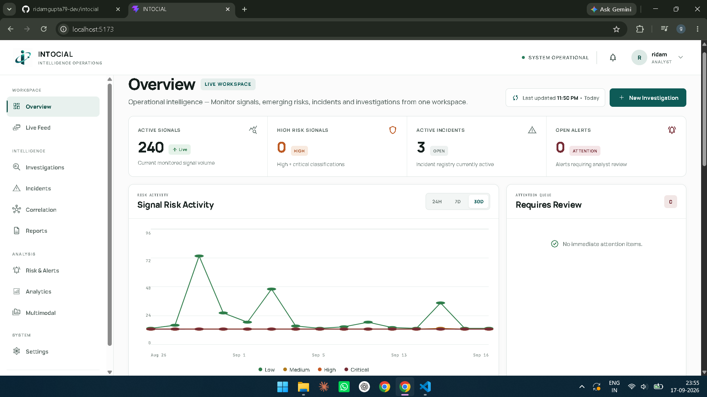
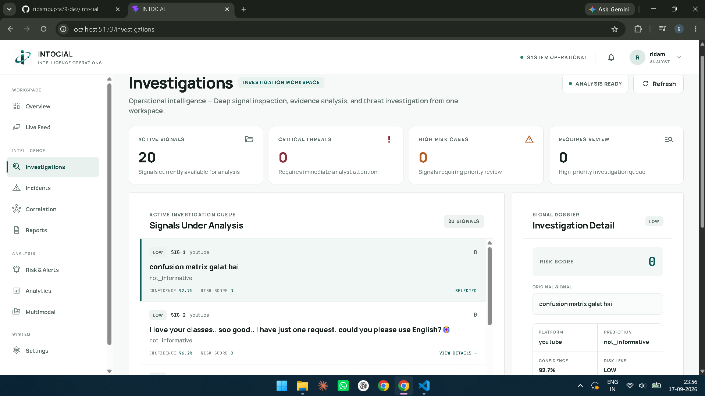
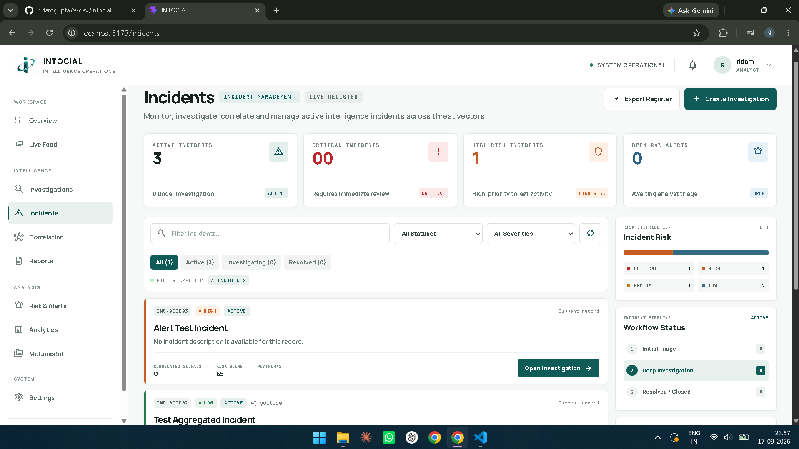
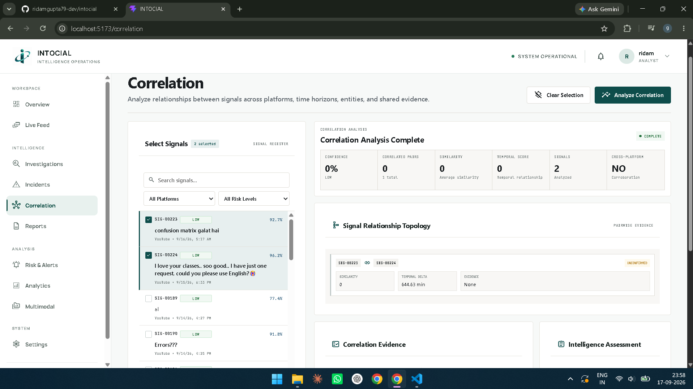
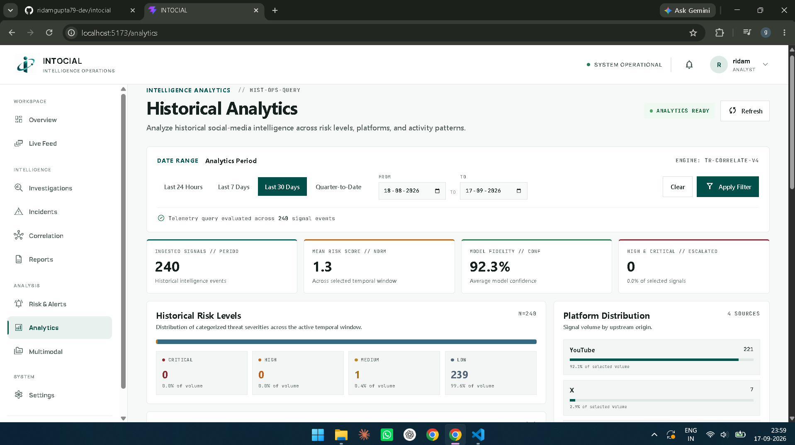
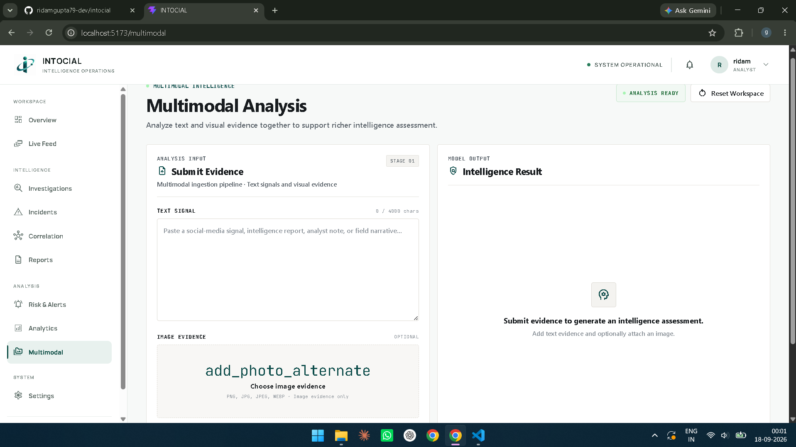

<div align="center">

# INTOCIAL

### Intelligence Operations & Social Intelligence Analysis

**From fragmented social signals to evidence-aware investigations.**

An AI-assisted social intelligence platform that helps analysts discover, examine, correlate, and investigate emerging claims and potential threats through one operational workspace.

[Explore the TinyFish Integration](#-tinyfish-live-web-intelligence) · [Platform Screenshots](#-platform-screenshots) · [Run Locally](#installation)

</div>

---

## Why INTOCIAL?

Online incidents can unfold across multiple platforms, while useful context is scattered across posts, pages, and public statements. INTOCIAL brings signal analysis, incident correlation, risk indicators, and live-web research into a single investigation workflow.

A key part of this workflow is the **TinyFish Search + Fetch integration**: instead of relying only on a static dataset or an analyst manually opening search results, the Investigations workspace can request current web results and retrieve readable page content to support further review. The results are investigative leads—not an automatic verdict—and should be checked against their original sources.

## Contents

- [Platform Overview](#overview)
- [Key Capabilities](#key-capabilities)
- [TinyFish Live Web Intelligence](#-tinyfish-live-web-intelligence)
- [Core Capabilities](#core-capabilities)
- [Architecture](#architecture)
- [Technology Stack](#technology-stack)
- [Installation](#installation)
- [API Areas](#api-areas)
- [Platform Screenshots](#-platform-screenshots)
- [Implementation Status & Limitations](#current-implementation-status)
- [Responsible Use](#responsible-use)

## Overview

Modern social platforms generate large volumes of fragmented and rapidly changing information. INTOCIAL is designed to transform these signals into structured intelligence that can be reviewed, correlated, and investigated from a single workspace.

### Key Capabilities

- Multi-source social signal ingestion
- AI-assisted risk and threat analysis
- Entity and contextual analysis
- Explainable risk scoring
- Incident creation and management
- Cross-signal and cross-platform correlation
- Temporal and event-level correlation
- Risk alerts and acknowledgement workflows
- Image-based multimodal analysis
- Historical analytics and anomaly detection
- Intelligence report generation
- Authenticated API access
- Operational investigation dashboard
- **TinyFish-powered live web research** from the Investigations workspace

## 🔎 TinyFish Live Web Intelligence

TinyFish is a major external API integration in INTOCIAL. It gives the investigation workflow a way to reach beyond the platform's ingested signals and query the **live web** for relevant sources. This is especially useful when a claim is new, context is changing, or an analyst needs material to examine alongside social signals.

### Why this matters

| Without live-web research | With TinyFish in INTOCIAL |
|---|---|
| An analyst may need to leave the dashboard and search manually. | The Investigations page includes a web-search workflow inside the product. |
| A static demo dataset can miss newly published context. | Search can request current web results when the feature is used. |
| Search-result snippets alone may not provide enough context. | The backend can fetch selected URLs and work with returned page content. |
| Research steps can be disconnected from the investigation workflow. | Web research is accessible from the same Investigations workspace as the platform's other investigation tools. |

### Where it appears in the project

- **Frontend:** `dashboard/src/pages/Investigations.jsx` — the Investigations page includes the independent web-search interface and renders the returned results.
- **Frontend API client:** `dashboard/src/services/api.js` — `searchWebWithTinyFish(...)` and `investigateWithTinyFish(...)` call the backend.
- **Backend route:** `src/api/tinyfish_routes.py` — exposes `POST /api/tinyfish/investigate` and validates the request.
- **TinyFish service layer:** `src/services/tinyfish_service.py` — sends requests to TinyFish Search and Fetch and assembles the investigation response.
- **Backend registration:** `src/api/main.py` — registers the TinyFish router with the FastAPI application.
- **Credential configuration:** `.env` — stores `TINYFISH_API_KEY` locally. The key must never be committed.

### Investigation flow

```text
Analyst enters a claim or web query
                |
                v
Investigations UI (React)
                |
                v
Frontend API client (Axios)
                |
                v
FastAPI: POST /api/tinyfish/investigate
                |
                v
TinyFish service layer
       |                 |
       v                 v
  TinyFish Search    TinyFish Fetch
  Discover URLs      Retrieve page content
       |                 |
       +--------+--------+
                |
                v
Structured investigation response
                |
                v
Results shown in the Investigations workspace
                |
                v
Analyst reviews sources and verifies context
```

### TinyFish APIs used

**1. TinyFish Search — source discovery**

The service sends a query to `https://api.search.tinyfish.ai` using the `X-API-Key` header. Search helps discover relevant web pages and returns structured results such as titles, URLs, and snippets.

**2. TinyFish Fetch — page retrieval**

For selected URLs, the service sends a request to `https://api.fetch.tinyfish.ai`. The intended response format is Markdown, which makes page text easier for downstream processing and analyst review than raw page markup.

Official references: [TinyFish Search](https://www.tinyfish.ai/search) · [TinyFish Search & Fetch overview](https://www.tinyfish.ai/free-search-fetch) · [TinyFish Cookbook / REST examples](https://github.com/tinyfish-io/tinyfish-cookbook)

### Backend endpoint

`POST /api/tinyfish/investigate`

Example request:

```json
{
  "claim": "Example public claim or event to investigate",
  "limit": 5
}
```

- `claim`: required text to investigate (3–500 characters).
- `limit`: optional result limit from 1 to 5; defaults to `5`.
- The backend reads `TINYFISH_API_KEY` from the environment.
- The route returns a client error for invalid input and a gateway error if the provider investigation fails.

### Configure the API key

Add the key to your **local `.env` file**:

```env
TINYFISH_API_KEY=your_key_here
```

Do not paste a real key into this README, `.env.example`, screenshots, issue reports, or Git commits. Keep `.env` ignored by Git. If a key has ever been exposed, revoke it and create a replacement.

### Responsible interpretation and deployment notes

TinyFish supplies web search and page-retrieval capabilities; it does **not**, by itself, prove a claim true or false. Search results can be incomplete, pages can change, and sources can disagree. Analysts should open and evaluate the original sources, compare independent evidence, and treat the returned material as leads for human review.

Before public deployment, protect the investigation endpoint with the application's authentication and appropriate rate limiting, and verify the provider response handling with real test queries. API availability, quotas, network conditions, and source-page behavior can affect results.

## Core Capabilities

### Social Signal Ingestion

INTOCIAL uses a common signal-processing architecture for multiple social platforms.

| Source | Current Status |
|---|---|
| YouTube | Real API ingestion |
| Reddit | Simulated / mock ingestion |
| X | Simulated / mock ingestion |
| Instagram | Simulated / mock ingestion |

YouTube is currently the primary real external-data ingestion source. The other connectors use simulated data for development and demonstration.

### AI-Powered Risk Analysis

Signals are processed through an analytical pipeline containing components for:

- NLP processing
- Entity extraction
- Contextual analysis
- Risk scoring
- Threat indicators
- Explainable risk components
- Anomaly detection
- Signal-level intelligence

The system is designed to expose analytical evidence behind risk assessments rather than relying only on an opaque prediction.

### Incident Intelligence

Related signals can be grouped into incidents based on similarity and contextual relationships.

The incident workflow supports:

- Incident creation
- Signal attachment
- Incident risk calculation
- Similarity-based grouping
- Signal aggregation
- Incident-level intelligence
- Incident management

### Correlation Engine

INTOCIAL correlates signals across multiple dimensions:

- Content similarity
- Entity overlap
- Cross-platform corroboration
- Temporal relationships
- Event-level relationships

This helps transform fragmented signals into connected investigative evidence.

### Risk & Alerts

The alerting layer provides:

- Risk-based alerts
- Alert severity
- Alert details
- Alert acknowledgement
- Connection between analytical risk and operational review

### Multimodal Analysis

INTOCIAL currently supports image-based multimodal analysis.

The system can analyze image inputs as part of the intelligence workflow.

Video analysis is not currently implemented.

### Analytics

The analytics workspace provides:

- Historical risk trends
- Platform distribution
- Risk distribution
- High-risk activity
- Anomaly detection
- Historical signal analysis

### Intelligence Reports

Investigations and incidents can be converted into structured intelligence reports containing analytical evidence and explanations for further review.

## Architecture

                    +---------------------+
                    |   Social Sources    |
                    | YouTube / Reddit /  |
                    | X / Instagram       |
                    +----------+----------+
                               |
                               v
                    +---------------------+
                    |   Signal Ingestion  |
                    |   & Normalization   |
                    +----------+----------+
                               |
                               v
                    +---------------------+
                    |     AI Analysis     |
                    | NLP / Entities /    |
                    | Context / Risk      |
                    +----------+----------+
                               |
              +----------------+----------------+
              |                |                |
              v                v                v
       +------------+   +------------+   +------------+
       | Incidents  |   | Correlation|   |   Alerts   |
       +-----+------+   +------+-----+   +------+-----+
             |                 |                |
             +-----------------+----------------+
                               |
                               v
                    +---------------------+
                    | Intelligence Layer |
                    | Reports / Analytics |
                    +----------+----------+
                               |
                               v
                    +---------------------+
                    |  INTOCIAL Dashboard |
                    | Investigation UI    |
                    +---------------------+

## Technology Stack

### Backend

- Python
- FastAPI
- Pydantic
- SQLAlchemy
- PostgreSQL
- psycopg2
- JWT authentication

### AI / Machine Learning

- PyTorch
- Hugging Face Transformers
- scikit-learn
- spaCy
- NumPy
- Pandas
- Pillow

### Frontend

- React
- Vite
- React Router
- Axios
- Recharts
- Lucide React

### Development & Testing

- Pytest
- Jupyter
- Conda
- Git

## Project Structure

social-media-analytics/
|
+-- dashboard/
|   +-- public/
|   +-- src/
|       +-- components/
|       +-- pages/
|       +-- services/
|   +-- package.json
|   +-- vite.config.js
|
+-- data/
|   +-- raw/
|   +-- processed/
|   +-- live/
|
+-- models/
|   +-- distilbert-crisisbench/
|   +-- risk_config.json
|
+-- notebooks/
|
+-- src/
|   +-- api/
|   +-- data/
|   +-- database/
|   +-- models/
|   +-- services/
|
+-- tests/
|
+-- migrate_signals.py
+-- simulate_stream.py
+-- requirements.txt
+-- .env.example
+-- .gitignore
+-- README.md

## Prerequisites

Before running INTOCIAL locally, install:

- Python 3.x
- Node.js
- PostgreSQL
- Git
- Conda or another Python environment manager

## Installation

### 1. Clone the Repository

git clone https://github.com/ridamgupta79-dev/intocial.git
cd intocial

### 2. Create the Python Environment

conda create -n social-media-analytics python=3.12
conda activate social-media-analytics

### 3. Install Python Dependencies

pip install -r requirements.txt

### 4. Install the spaCy Language Model

python -m spacy download en_core_web_sm

## Environment Configuration

Create a local .env file from the provided template.

On Windows PowerShell:

Copy-Item .env.example .env

Configure the required credentials and database connection inside .env.

The project uses the following environment variables:

X_API_KEY=
X_API_SECRET=
X_ACCESS_TOKEN=
X_ACCESS_TOKEN_SECRET=

REDDIT_CLIENT_ID=
REDDIT_CLIENT_SECRET=
REDDIT_USER_AGENT=

YOUTUBE_API_KEY=

INSTAGRAM_ACCESS_TOKEN=

DATABASE_URL=

SECRET_KEY=

Never commit .env or real API credentials to GitHub.

## Database

INTOCIAL uses PostgreSQL for persistent application data.

Configure the PostgreSQL connection through:

DATABASE_URL=

The project includes database initialization and migration-related functionality.

## Running the Backend

From the project root:

uvicorn src.api.main:app --reload

Backend:

http://localhost:8000

FastAPI documentation:

http://localhost:8000/docs

## Running the Frontend

Open a second terminal:

cd dashboard
npm install
npm run dev

Frontend:

http://localhost:5173

## API Areas

The backend provides functionality across areas including:

/auth
/predict
/analyze
/analyze-multimodal
/ingest
/ingest/youtube
/ingest/reddit
/ingest/x
/ingest/instagram
/incidents
/alerts
/correlation
/reports
/analytics
/api/tinyfish/investigate
/health

Interactive API documentation is available through FastAPI Swagger UI at:

http://localhost:8000/docs

## Security

The application includes security measures such as:

- JWT-based authentication
- Protected intelligence endpoints
- Authenticated frontend API requests
- Restricted development CORS configuration
- Environment-based secret management
- Image upload validation
- File-size restrictions for image uploads
- Sensitive configuration excluded through .gitignore

## Dataset

Parts of the machine-learning workflow use the CrisisMMD / CrisisBench dataset for model development and experimentation.

The dataset is not included in this repository.

Large raw datasets, processed datasets, and generated data are excluded from GitHub.

To reproduce the relevant ML experiments, obtain the required dataset separately and place it in the expected local data directories.

## Model Artifacts

Large trained model weights and training checkpoints are intentionally excluded from GitHub.

The repository keeps lightweight configuration and tokenizer files where useful, while large model artifacts such as:

*.safetensors
*.pt
*.pth
*.pkl

are excluded.

This keeps the repository manageable while preserving the source code and model configuration.

## Testing

Run the test suite with:

pytest

The project contains tests covering major application workflows including:

- Authentication
- Risk analysis
- Incidents
- Alerts
- Correlation
- Intelligence workflows
- API functionality

## Current Implementation Status

INTOCIAL is currently a local research and prototype platform.

The implemented system has been tested across:

- Frontend workflows
- Backend API workflows
- Authentication and session handling
- Signal ingestion
- Risk analysis
- Incident workflows
- Correlation workflows
- Alert workflows
- Multimodal image analysis
- Analytics
- Intelligence reporting

The YouTube connector is currently the primary real external-data ingestion path.

Reddit, X, and Instagram connectors currently use simulated data for development and demonstration.

## Limitations

Current limitations include:

- Reddit ingestion is simulated.
- X ingestion is simulated.
- Instagram ingestion is simulated.
- Multimodal analysis currently focuses on images.
- External API availability depends on provider credentials and quotas.
- Large ML model weights are not distributed with the repository.
- The current system is intended for local development and demonstration rather than production deployment.

## Roadmap

Potential future development includes:

- Production-grade social platform integrations
- Distributed ingestion workers
- Real-time streaming infrastructure
- Scalable intelligence processing
- Advanced multimodal models
- Entity knowledge graphs
- Analyst collaboration workflows
- Production deployment
- Expanded automated evaluation and monitoring

## Responsible Use

INTOCIAL is designed as an intelligence analysis and decision-support platform.

Risk scores, correlations, alerts, and analytical outputs should be treated as investigative signals requiring appropriate human review and contextual verification rather than as automatically established facts.

## Author

Ridam Gupta

AI / Machine Learning · Software Development · Data & Intelligence Systems

## Project

INTOCIAL — Intelligence Operations & Social Intelligence Analysis

An AI/ML engineering project combining machine learning, data processing, backend systems, correlation intelligence, and an operational investigation interface.

## 📸 Platform Screenshots

These screenshots provide a quick tour of the current INTOCIAL interface. They are loaded from `docs/screenshots/` in the repository.

> **For the hackathon demo:** keep the screenshots in the exact paths below and make sure they are committed to GitHub. The Investigations screenshot is especially relevant to the TinyFish workflow.

<table>
  <tr>
    <td align="center" width="50%">
      <strong>Overview Dashboard</strong><br/>
      <sub>High-level operational view</sub><br/><br/>
      
    </td>
    <td align="center" width="50%">
      <strong>Investigations &amp; TinyFish Research</strong><br/>
      <sub>Investigation workspace and web-search entry point</sub><br/><br/>
      
    </td>
  </tr>
  <tr>
    <td align="center" width="50%">
      <strong>Incident Management</strong><br/>
      <sub>Group and review related signals</sub><br/><br/>
      
    </td>
    <td align="center" width="50%">
      <strong>Cross-Signal Correlation</strong><br/>
      <sub>Explore relationships between signals</sub><br/><br/>
      
    </td>
  </tr>
  <tr>
    <td align="center" width="50%">
      <strong>Analytics</strong><br/>
      <sub>Historical trends and risk distribution</sub><br/><br/>
      
    </td>
    <td align="center" width="50%">
      <strong>Multimodal Image Analysis</strong><br/>
      <sub>Image-focused analytical workflow</sub><br/><br/>
      
    </td>
  </tr>
</table>

---

## Author

**Ridam Gupta**

AI / Machine Learning · Software Development · Data & Intelligence Systems

## Project Summary

INTOCIAL combines social-signal analysis, correlation intelligence, incident workflows, multimodal image analysis, and TinyFish-powered live-web research in an operational investigation interface. It is a research and prototype platform, with external-source findings intended to support—not replace—human review.
